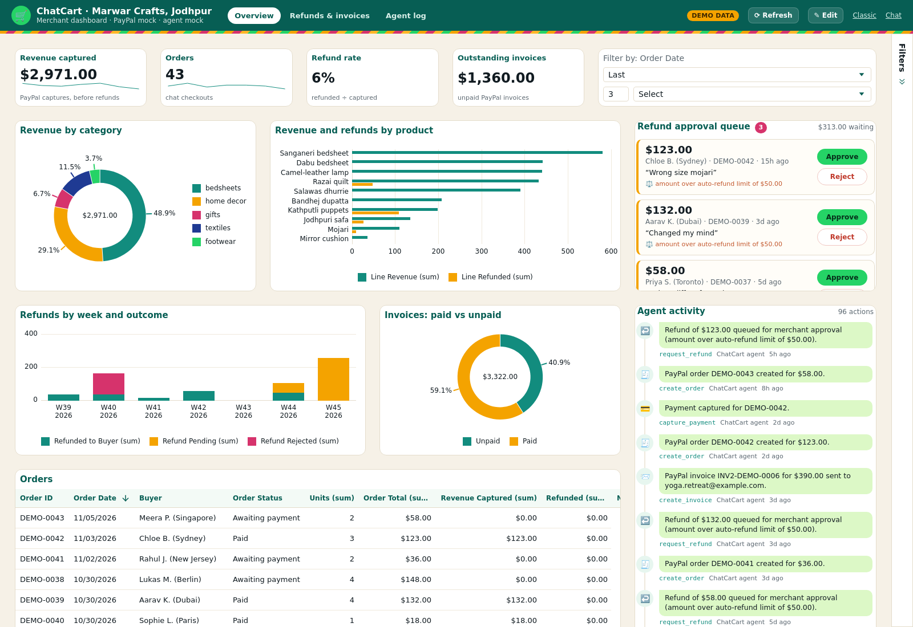

# ChatCart 🧵💬💳

**An AI shop agent that doesn't just recommend, it transacts.** ChatCart lets a small Indian merchant sell, take payment, refund and invoice inside a WhatsApp-style chat, powered by PayPal's Orders v2, Payments and Invoicing APIs and an LLM that calls them as tools.

Demo store: *Marwar Crafts*, a handicrafts & textiles shop in Jodhpur, Rajasthan (Dabu block-print bedsheets, Salawas dhurries, mojaris, kathputli puppets).

Built for the **PayPal AI Hackathon** (Devpost, 2026). MIT licensed.

---

## The problem

Millions of small Indian sellers (artisans, boutiques, handicraft shops) already sell over WhatsApp. But every sale is manual: send photos, quote prices, share a UPI ID or payment link, check screenshots, reconcile, and handle refunds by hand. International buyers (tourists, NRIs, gift buyers) can't easily pay at all.

Chatbots today stop at "recommendations". The hard, valuable part, **moving money safely**, is still done by the shop owner at 11 pm.

## The solution

ChatCart is an AI agent with real payment tools:

| Buyer says | Agent does | PayPal API |
|---|---|---|
| "show me bedsheets" | searches catalog, shows product cards | – |
| "add 2 bs-dabu" | builds the cart | – |
| "checkout" | creates an order, returns an approval link | **Orders v2** `POST /v2/checkout/orders` |
| *(buyer approves on PayPal)* | captures the payment | **Orders v2** `POST /v2/checkout/orders/{id}/capture` |
| "where is my order?" | live status lookup | **Orders v2** `GET /v2/checkout/orders/{id}` |
| "refund $10, dye stain" | refunds within policy, or queues for owner | **Payments v2** `POST /v2/payments/captures/{id}/refund` |
| "bulk order of 20 cushion covers, invoice to x@y.com" | creates and sends an invoice | **Invoicing v2** create + send |

The **merchant dashboard** (`/dashboard`) shows orders, revenue, refunds (with Approve/Reject for anything the policy held back), invoices, and a full **agent actions log**: every tool call the AI made, with arguments and result.

### Guardrails are code, not prompts
The LLM can *ask* for anything; the tools enforce merchant policy:
- Refunds above `AUTO_REFUND_LIMIT` (default $50) or outside `REFUND_WINDOW_DAYS` are **queued for merchant approval**, never executed by the AI.
- Refunds can never exceed the remaining captured amount; one pending refund per order.
- Buyers can only see and act on orders from their own chat session.
- Orders of `BULK_QTY_THRESHOLD`+ units are steered to a PayPal invoice instead of instant checkout.
- Capture is refused (with a fresh pay link) until the buyer has actually approved on PayPal.

## Demo flow (works with zero keys)

```
Buyer:  show me bedsheets                → 3 product cards
Buyer:  add 2 bs-dabu                     → cart $68
Buyer:  add a kathputli puppet            → cart $86
Buyer:  checkout                          → "Pay $86.00 with PayPal" button (PayPal order created)
Buyer:  I have paid  (too early)          → "Payment isn't approved yet" + pay link again
        …taps Pay → PayPal approval page → Complete Purchase → redirected back, payment captured
Buyer:  I have paid                       → 🎉 Order COMPLETED
Buyer:  Refund $10 – one bedsheet has a small dye stain → 💸 $10 refunded instantly (under $50 policy)
Buyer:  refund the rest, the parcel arrived late          → $76 queued: PENDING_MERCHANT_APPROVAL
Owner:  /dashboard → Approve                              → refund executed, order REFUNDED
Buyer2: I need a bulk order of 20 mirror cushion covers, send invoice to hotel.umaid@example.com
                                          → 📨 PayPal invoice for $240 sent
```

## Architecture

```
 Browser (WhatsApp-style chat)      Merchant dashboard (/dashboard)
          │ POST /api/chat                    │ GET /api/dashboard, POST approve/reject
          ▼                                   ▼
 ┌──────────────────────── Express (src/app.js) ─────────────────────────┐
 │  Agent (src/agent)                                                     │
 │   ├─ llm.js   OpenAI-compatible function calling loop (real mode)      │
 │   └─ rules.js deterministic intent parser (mock mode / LLM fallback)   │
 │            │ both call the SAME tools ▼                                │
 │  Tools (src/tools.js)  search_catalog · add_to_cart · remove_from_cart │
 │   view_cart · create_checkout · capture_payment · get_order_status     │
 │   request_refund (policy guardrails) · create_invoice  → action log    │
 │            │                                                           │
 │  PayPal adapter (src/paypal)                                           │
 │   ├─ client.js  REST: OAuth2, Orders v2, Payments v2, Invoicing v2     │
 │   └─ mock.js    same interface + state machine, fake approval page     │
 └────────────────────────────────────────────────────────────────────────┘
```

- **AI**: any OpenAI-compatible chat-completions endpoint with tool calling (OpenRouter, Gemini OpenAI endpoint, Groq, OpenAI). The model chooses tools; results (product cards, pay button, refund status) are rendered as rich chat cards. If the LLM call fails, the rule-based agent answers so the shop never goes silent.
- **PayPal**: direct REST calls to `api-m.sandbox.paypal.com` with idempotency keys (`PayPal-Request-Id`) on create/capture/refund. The tool layer is written so it could be swapped for [`@paypal/agent-toolkit`](https://www.npmjs.com/package/@paypal/agent-toolkit).
- **Return URL**: after approval PayPal redirects to `/paypal/return`, which captures immediately and drops the buyer back into the chat.
- **Storage**: in-memory (demo). Swap `src/store.js` for SQLite/Postgres for production.

## Setup

Requires Node 22+.

```bash
npm install
cp .env.example .env      # optional; without keys everything runs in MOCK mode
npm start                 # http://localhost:3000  and  http://localhost:3000/dashboard
```

Mode is shown in the chat header badge (`paypal: mock|sandbox · llm: mock|llm`).

### Real mode
1. **PayPal sandbox**: at https://developer.paypal.com → *Apps & Credentials* (Sandbox) → *Create App* (merchant). Put `PAYPAL_CLIENT_ID` / `PAYPAL_CLIENT_SECRET` in `.env`. Use the auto-created **sandbox personal account** (Testing Tools → Sandbox Accounts) to pay. Invoicing is enabled on sandbox business accounts by default.
2. **LLM**: set `LLM_BASE_URL`, `LLM_API_KEY`, `LLM_MODEL` (examples in `.env.example`). Pick a model with tool-calling support.
3. If deployed, set `BASE_URL` to the public URL so PayPal can redirect back.

### Docker
```bash
docker compose up --build
```

### Tests & lint
```bash
npm test     # node:test: intent parsing, full mock flow via HTTP, LLM tool loop, PayPal request shapes, AG Studio data + AI proxy
npm run lint
```
CI runs both, typechecks and builds the AG Studio dashboard, plus a Docker build on every push (`.github/workflows/ci.yml`).

## Merchant dashboard on AG Studio

`/dashboard` is a merchant analytics dashboard built with **[AG Studio](https://www.ag-grid.com/studio/)** (AG Grid's embedded analytics, which uses AG Grid and AG Charts underneath). The original hand-built dashboard is still at `/dashboard/classic`.



**Sponsor tools used:** AG Studio 3.0 (`ag-studio`, `ag-studio-react`), AG Grid 36.2 (grid widgets), AG Charts (chart widgets), the **AG Studio Agent Framework** (AI harness, built-in agents, custom tools), plus PayPal Orders v2, Payments refunds and Invoicing v2 as the data behind it.

What's in it:
- **Report "Marwar Crafts, Jodhpur"** with three pages:
  - *Overview*: KPI tiles (revenue captured, orders, refund rate, outstanding invoice $) with weekly sparklines, a date filter, revenue by category, revenue and refunds by product, refunds by week and outcome, invoices paid vs unpaid, and an orders grid.
  - *Refunds & invoices*: refund rate by product, refund reasons, the refund request log, PayPal invoices.
  - *Agent log*: what the agent did, by tool and actor, plus the full agent actions log grid.
- **Two custom widgets** (in the widget menu under *ChatCart*), both reading through Studio's query engine so the date filter and cross filters apply:
  - **Refund approval queue**: refunds the agent held back (over the auto-refund limit or outside the window), with **Approve / Reject** buttons that call `POST /api/merchant/refunds/:id/approve|reject`. Studio reloads its data afterwards, so the KPIs and charts update too.
  - **Agent activity feed**: a WhatsApp-style timeline of every tool the agent (and the merchant) ran.
- **Custom theme**: WhatsApp greens on a Jodhpur-sandstone canvas, saffron/bandhej/dabu-indigo chart palette and a leheriya stripe under the header. Every Studio, grid and chart colour points at one set of CSS tokens (`studio/src/styles.css`, `studio/src/studio/theme.ts`).
- **Layout tools**: Edit mode (Compose / Data panels, drag-resize, add pages), undo/redo, *Save layout* (kept in the browser) and *Reset*.
- **AI (Agent Framework)**: click **Edit** to open the AI Assistant. A custom primary agent, **ChatCart Ops**, starts from Studio's built-in Lead (its instructions and `delegate_to`), adds shop knowledge plus two custom tools (`get_shop_policy`, `get_refund_queue`), and hands dashboard work to Studio's built-in **Planning, Data, Page and Widget** agents. Try *"Show refund rate by product this week"* or *"Which refunds need me?"*. The custom widgets carry AI metadata so the agents can place them.
- **Demo data**: in mock mode the shop is seeded with ~6 weeks of realistic demo orders, refunds and invoices (flagged `demo`, badge in the header, never sent to PayPal). `DEMO_SEED=0` starts empty, `DEMO_SEED=1` forces it on.

How it's wired:
- `studio/` is a small React + Vite + TypeScript app. It builds to `public/studio/`, which Express serves at `/dashboard` (behind the same `DASHBOARD_PASSWORD` basic auth). The Express app stays plain JS.
- `GET /api/studio/data` (`src/studio-data.js`) turns the store into flat, related tables: `orders`, `orderItems` (product, category, refunds spread over lines by value), `products`, `refunds`, `invoices`, `agentActions`. `studio/src/studio/data.ts` declares the fields, relationships, a shared calendar and the `refundRate` / `productRefundRate` / `collectionRate` measures.
- `POST /api/studio/ai/responses` (`src/studio-ai.js`) is a server-side proxy for Studio's OpenAI Responses adapter: it adds the key, allows only the configured models, caps output tokens and streams the SSE reply back. The key never reaches the browser; with no key the assistant is hidden.

Environment:

| Variable | Purpose |
| --- | --- |
| `AG_STUDIO` | AG Studio licence key (optional; trial watermark without it) |
| `AG_STUDIO_OPENAI_API_KEY` | Key for the AI assistant (OpenAI Responses API). Falls back to `LLM_API_KEY` + `LLM_BASE_URL` + `LLM_MODEL`; that endpoint must support `/responses`. |
| `AG_STUDIO_AI_BASE_URL` | Defaults to `https://api.openai.com/v1` |
| `AG_STUDIO_AI_MODELS` | Allowed models, comma-separated; the first is the default (`gpt-5.4-mini`) |
| `AG_STUDIO_AI_MAX_TOKENS` | Output token cap per turn (default 16000) |
| `DEMO_SEED` | `0` = no demo data, `1` = force demo data |

Run it:
```bash
npm install
npm run build        # builds the AG Studio dashboard into public/studio (installs studio/ deps)
npm start            # http://localhost:3000/dashboard  (classic: /dashboard/classic)
npm run dev:studio   # optional: Vite dev server for studio/ on :5173, proxying /api to :3000
```
On Render: Docker deploys build the dashboard in the Dockerfile's first stage. For a native Node service use build command `npm ci && npm run build` and start command `npm start`. Without a build, `/dashboard` falls back to the classic dashboard.

## API (for the curious)
- `POST /api/chat` `{sessionId, message}` → `{reply, attachments[], quickReplies[], cart, toolCalls[]}`
- `GET /api/dashboard` → stats, orders, refunds, invoices, actions
- `GET /api/studio/data` → flat related tables for AG Studio (orders, orderItems, products, refunds, invoices, agentActions) + licence/AI model settings
- `POST /api/studio/ai/responses` → AG Studio AI proxy (OpenAI Responses API, streamed)
- `POST /api/merchant/refunds/:id/approve|reject`
- `GET /api/health`, `GET /api/catalog`

## Roadmap
- Real WhatsApp Business Cloud API channel (same agent, same tools)
- Hindi / Marwari language replies, UPI via PayPal where available
- Persistent DB, merchant catalog upload (CSV/photos), PayPal webhooks for async status
- Shipping labels and tracking numbers via PayPal's `add tracking` API

## License
MIT. See [LICENSE](LICENSE).
